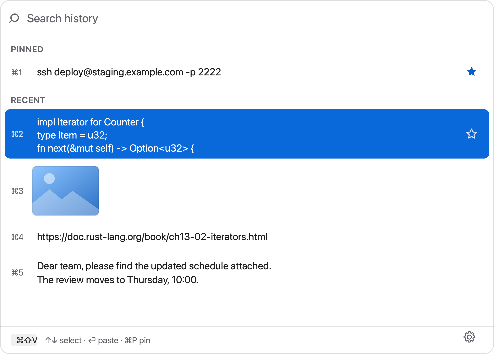

# Just Clipboard Manager


A lightweight clipboard history manager for macOS. Lives in the menu bar, opens
on a global hotkey, keeps what you copied — text and images — and puts any of it
back on the clipboard with one keystroke.

Built with Rust and Tauri, so the whole thing is a single native binary with no
runtime to install.

<picture>
  <source media="(prefers-color-scheme: dark)" srcset="assets/screenshot-dark.png">
  
</picture>

## Features

- **History of everything you copy** — plain text and images, captured by a
  background watcher that polls the system clipboard.
- **Pinned items** that never expire, separate from the rolling window of recent
  ones (the size of that window is configurable).
- **Image previews** — thumbnails in the list, full original on demand.
- **Search** across the history as you type.
- **Keyboard-first** — the panel is built to be used without touching the mouse.
- **Global hotkey** to summon the panel from any app, rebindable in settings.
- **17 interface languages**, remembered between launches.
- **Remembers its window size**, with an option to lock resizing entirely.
- **Deduplication** — copying the same thing twice moves it up instead of
  cluttering the list; images are deduplicated by content hash.

## Keyboard

| Key | Action |
| --- | --- |
| `↑` `↓` | Move through the list |
| `⏎` | Put the selected item back on the clipboard |
| `⌘1`–`⌘9` | Put one of the first nine items back immediately |
| `⌘P` | Pin / unpin the selected item (rebindable) |
| `Space` | Preview the original image (rebindable) |
| `⌘F` | Focus the search field |
| any letter | Starts searching right away |
| `Esc` | Clear the search, then leave the field |

## Requirements

- macOS (Apple Silicon or Intel)
- [Rust](https://rustup.rs) and Node.js 20+ to build from source

## Running from source

```sh
npm install
npm run tauri dev
```

## Building

```sh
npm run tauri build
```

The app lands in `src-tauri/target/release/bundle/`: a `.app` under `macos/` and
a disk image under `dmg/`. The default build targets your own CPU; for a binary
that runs on both Apple Silicon and Intel:

```sh
rustup target add x86_64-apple-darwin
npm run tauri build -- --target universal-apple-darwin
```

### A note on unsigned builds

The app is not signed with an Apple Developer ID, so macOS will refuse to open it
with a plain double-click after it has been downloaded. To open it anyway:
right-click the app, choose **Open**, then **Open** again in the dialog. Or lift
the quarantine flag directly:

```sh
xattr -dr com.apple.quarantine "/Applications/Just Clipboard Manager.app"
```

Signing and notarizing with a paid Apple Developer account removes the warning
entirely; Tauri supports it through the usual `APPLE_*` environment variables.

## Where data is kept

```
~/Library/Application Support/<bundle identifier>/
├── config.json     settings: hotkey, limit, language, window size, shortcuts
├── history.json    the history itself
└── images/         originals, with thumbnails in images/thumbs/
```

Images no longer referenced by the history are deleted as they fall out, and a
sweep on startup removes any orphans left behind.

## Project layout

The Rust side follows a dependency-rule layout: the domain knows nothing about
the outside world, and everything outer depends inward.

```
src-tauri/src/
├── domain/           entities and rules: ClipItem, Entry, History, Config
├── application/      ports (traits) and use cases
├── infrastructure/   adapters: JSON stores, filesystem image store
├── commands.rs       Tauri commands and the DTOs the UI receives
├── watcher.rs        background clipboard polling thread
└── lib.rs            composition root — wires the pieces together
```

Storage is reached only through traits (`HistoryStore`, `ImageStore`,
`ConfigStore`), so the JSON implementations can be swapped without touching the
domain.

The frontend is a single Vue component plus a translation dictionary.

## Roadmap

- Abstract the system clipboard behind a port, the way storage already is
- Case-insensitive search
- Auto-paste into the focused app (needs accessibility permissions)
- Optional "stay on top" toggle, including over full-screen apps
- Signed and notarized builds

## Contributing

Issues and pull requests are welcome. The project is small on purpose — if you
want to add something sizeable, open an issue first so we can agree on the shape
before you write the code.

Run `cargo test` inside `src-tauri/` before sending a change; the domain layer is
covered by tests and they are fast.

By sending a pull request you agree that your contribution may be relicensed by
the project owner, who keeps the right to offer the code under terms other than
GPL-3.0. This keeps dual licensing possible.

## License

GPL-3.0 — see [LICENSE](LICENSE).

In short: you are free to use, study, modify and share this software. If you
distribute a modified version, it has to stay open under the same license.

The copyright is held by the author, so if the copyleft terms do not work for
your case, a separate commercial license can be arranged — open an issue to get
in touch.
